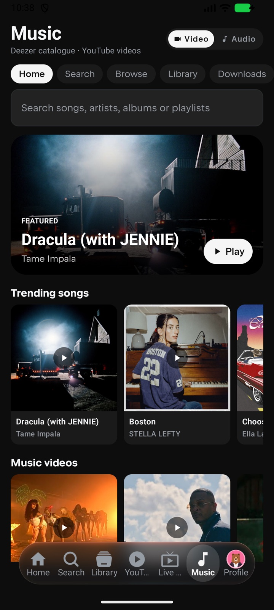
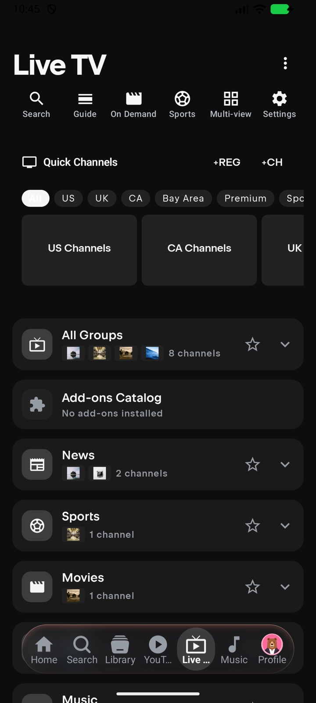
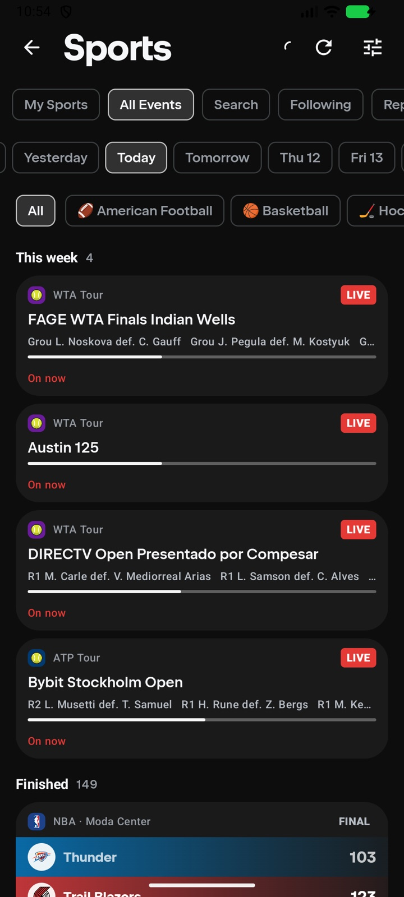
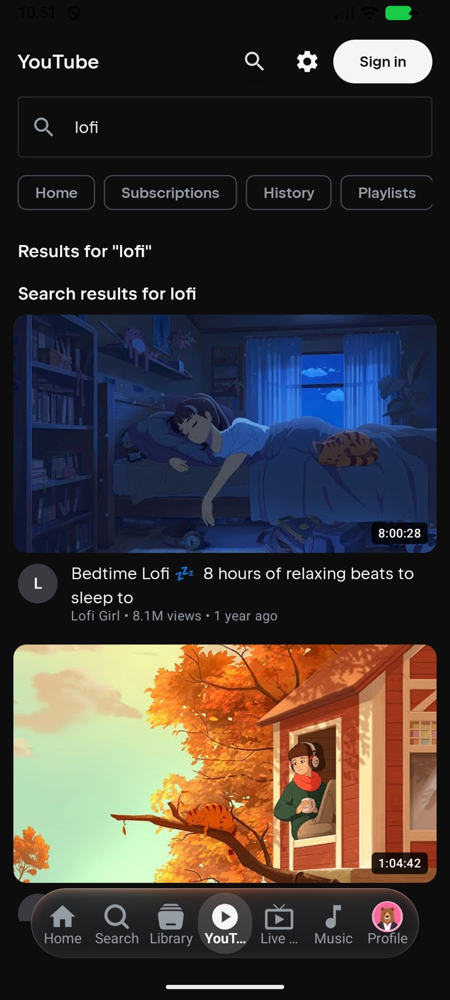
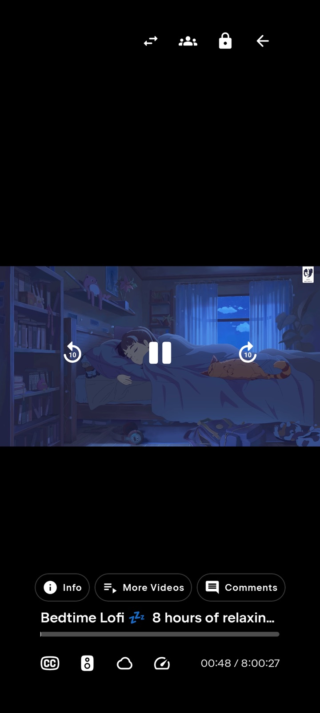
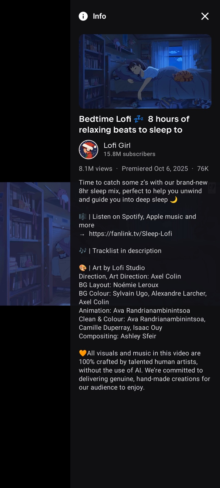

# Lucid Nuvio IPTV+ Mobile

**Live TV, sports, movies, series, YouTube and a full music hub — in one Android app.**

[Install](#-install) · [Features](#-features) · [Screenshots](#-screenshots) · [Credits](#-credits) · [Legal](#-legal)

---

## 📱 Screenshots

| Music | Live TV | Sports |
|:---:|:---:|:---:|
|  |  |  |
| **YouTube** | **Player** | **Video info** |
|  |  |  |

---

## ✨ Features

### 📺 Live TV your way
- A full TV guide with channels, now/next programmes and a live time line.
- Multiple M3U playlists and XMLTV guides, merged into one guide.
- Xtream logins, including your provider's movies and series.
- Favourites, hidden groups, channel reordering and custom channel logos.
- Catch-up, reminders and recordings.
- Quick Channels for fast switching without leaving the player.
- Channels access for every Live TV source, including catch-up and recordings.
- Multi-view for watching more than one channel at once.

### 🏆 Sports
- Scores, schedules and which of your channels are showing each game.
- Follow teams and leagues, with reminders and scoring alerts.
- A Replays tab with highlights and event videos.
- Pre-event and post-event videos on every game page.

### 🎵 Music
- Browse, search and discover songs, artists, albums and playlists.
- Like songs, follow artists, build playlists and download for offline listening.
- Music videos or audio-only playback, with synced lyrics.
- Shuffle and repeat modes, a queue view and a full-screen player.
- Crossfade into the next track over the last 20 seconds.
- Player controls and the navigation bar step aside after five seconds and return on touch.

### ▶️ YouTube
- Home, Subscriptions, History, Playlists, Channels, Live, Music, Gaming, News, Sports and Shorts.
- Search and play videos in the app's own player.
- Info, More Videos and Comments panels on the player.
- Auto-play the next video when one finishes.
- YouTube videos in Continue Watching.

### 🎬 Movies, series and more
- On Demand with categories, search, sorting and quality tags.
- Addons, Library, Continue Watching and watch progress.
- Trakt, Simkl and MDBList integrations.
- Subtitles, parental controls and multiple profiles.
- A player that follows your device orientation, with in-app PiP and gesture controls.

---

## 📦 Install

1. Open the [latest release](https://github.com/lucidconviction/lucid-nuvio-iptvplus-mobile/releases/latest).
2. Download the APK for your device:
   - **arm64-v8a** — most modern phones and tablets
   - **armeabi-v7a** — older 32-bit devices
   - **x86_64** — emulators and x86 devices
3. Open the downloaded APK and allow installs from your browser or file manager if Android asks.
4. Launch **Lucid Nuvio IPTV+ Mobile** and add your own playlist or provider.

**Requirements:** Android 7.0 or newer.

The app ships with no channels, playlists or media. You choose your own sources. It installs alongside the official Nuvio app and other Nuvio-based clients.

---

## 🔄 Updates

The app can check for new versions from inside **Settings → About** and install the matching APK from the latest GitHub release. You can also download any new release manually from the link above.

---

## ☕ Support this fork

If you enjoy the app, you can buy me some tea — completely optional and very appreciated.

---

## 🙏 Credits

This project builds on the work of:

- **[NuvioMedia / Nuvio Mobile](https://github.com/NuvioMedia/NuvioMobile)** — the upstream Nuvio client.
- **[Nuvio + IPTV](https://github.com/homelessbrian/NuvioPlusIPTV)** and **[Nuvio + IPTV Mobile](https://github.com/homelessbrian/NuvioPlusIPTV-Mobile)** — Live TV, Sports, On Demand and the IPTV foundations.
- **[Nuvio One](https://github.com/zoga2o3-ops/Nuvio-One)** — inspiration for bringing IPTV, YouTube and music together.
- **[ghbarker / NuvioMobile-IPTV](https://github.com/ghbarker/NuvioMobile-IPTV)** — the original IPTV port of Nuvio Mobile.

Thank you to every developer, tester and contributor in those projects. This fork is unofficial and is **not affiliated with or endorsed by NuvioMedia**. Please report issues with this fork here, not to the upstream teams.

---

## ⚖️ Legal

This app is a client-side player. It does not host, store or distribute any media, and it ships with no channels, playlists or content sources. Only use sources you own or are authorised to access.

Licensed under the **GNU General Public License v3.0**, like upstream Nuvio. See [LICENSE](LICENSE).
